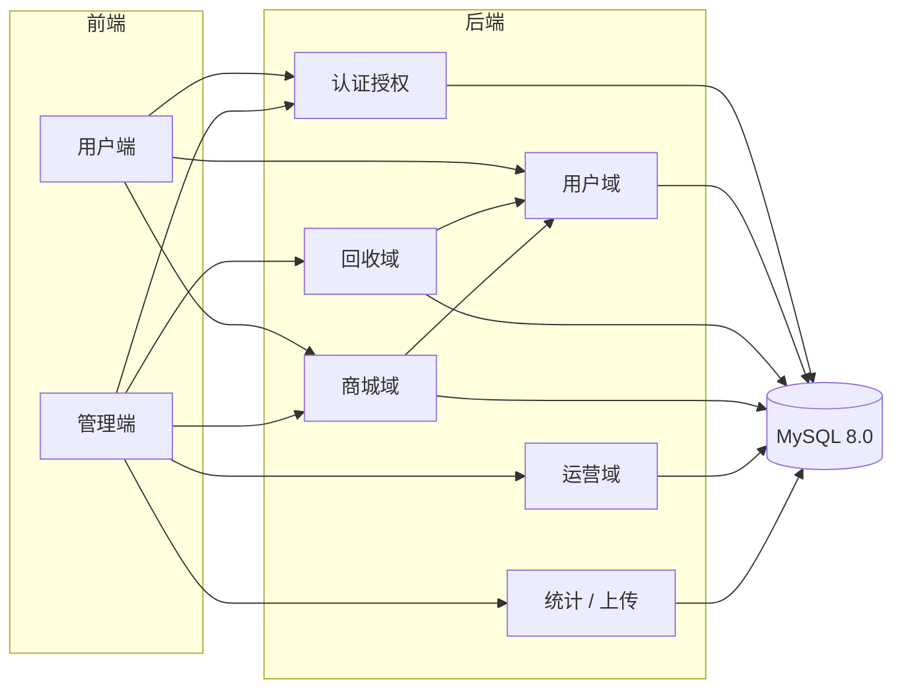

# 功能结构图

| 项目 | 内容 |
| --- | --- |
| 文档版本 | v1.0（阶段①评审稿） |
| 编写 | 魏鸿 |
| 关联文档 | [需求分析报告-v1.md](需求分析报告-v1.md)、[用例图-v1.md](用例图-v1.md)、[../api.md](../api.md) |
| 分解依据 | 按「三端」划分：用户端（USER）、管理端（RECYCLER + ADMIN）、后端服务（横切能力），与仓库目录 `user-web/`、`admin-web/`、`backend/` 一一对应 |

## 变更记录

| 版本 | 日期 | 修改人 | 说明 |
| --- | --- | --- | --- |
| v0.1 | 阶段①初稿 | 魏鸿 | 三层功能分解 |
| v1.0 | 阶段①评审稿 | 魏鸿 | 与需求编号 FR 对齐，补充模块职责与前后端归属 |

---

## 1. 总体功能结构

```mermaid
flowchart TD
    ROOT["校园垃圾回收积分系统"]

    ROOT --> P1["用户端（user-web）"]
    ROOT --> P2["管理端（admin-web）"]
    ROOT --> P3["后端服务（backend）"]

    %% ---------- 用户端 ----------
    P1 --> P1A["账号"]
    P1A --> P1A1["注册"]
    P1A --> P1A2["登录 / 登出"]
    P1A --> P1A3["个人资料"]
    P1A --> P1A4["修改密码"]
    P1A --> P1A5["身份二维码"]

    P1 --> P1B["我的回收"]
    P1B --> P1B1["投递记录"]
    P1B --> P1B2["投递详情"]

    P1 --> P1C["我的积分"]
    P1C --> P1C1["积分余额"]
    P1C --> P1C2["积分明细"]

    P1 --> P1D["积分商城"]
    P1D --> P1D1["商品列表 / 搜索"]
    P1D --> P1D2["商品详情"]
    P1D --> P1D3["积分兑换"]
    P1D --> P1D4["兑换记录"]

    P1 --> P1E["核销凭证"]
    P1E --> P1E1["核销码展示"]
    P1E --> P1E2["核销状态"]

    P1 --> P1F["信息与帮助"]
    P1F --> P1F1["系统公告"]
    P1F --> P1F2["环保科普"]
    P1F --> P1F3["异常申诉"]

    %% ---------- 管理端 ----------
    P2 --> P2A["公共"]
    P2A --> P2A1["登录"]
    P2A --> P2A2["个人中心 / 改密"]

    P2 --> P2B["回收员工作台"]
    P2B --> P2B1["识别用户"]
    P2B2["投递登记（发积分）"]
    P2B --> P2B2
    P2B --> P2B3["撤销申请"]
    P2B --> P2B4["兑换核销"]
    P2B --> P2B5["今日数据"]
    P2B --> P2B6["本人流水"]
    P2B --> P2B7["积分规则（只读）"]

    P2 --> P2C["管理员 - 规则与基础数据"]
    P2C --> P2C1["垃圾类别管理"]
    P2C --> P2C2["积分规则配置"]
    P2C --> P2C3["回收站点维护"]

    P2 --> P2D["管理员 - 商品与商城"]
    P2D --> P2D1["商品管理"]
    P2D --> P2D2["上下架"]
    P2D --> P2D3["库存调整"]

    P2 --> P2E["管理员 - 人员与账号"]
    P2E --> P2E1["用户账号管理"]
    P2E --> P2E2["回收员审核"]
    P2E --> P2E3["密码重置"]

    P2 --> P2F["管理员 - 业务与审计"]
    P2F --> P2F1["全量流水审计"]
    P2F --> P2F2["授权撤销"]
    P2F --> P2F3["违规积分调整"]
    P2F --> P2F4["兑换订单管理"]
    P2F --> P2F5["申诉处理"]

    P2 --> P2G["管理员 - 数据看板"]
    P2G --> P2G1["总量卡片"]
    P2G --> P2G2["分类占比"]
    P2G --> P2G3["趋势曲线"]
    P2G --> P2G4["TOP 排行"]

    P2 --> P2H["管理员 - 内容"]
    P2H --> P2H1["公告管理"]
    P2H --> P2H2["科普管理"]

    %% ---------- 后端 ----------
    P3 --> P3A["认证与授权"]
    P3A --> P3A1["注册 / 登录"]
    P3A --> P3A2["JWT 签发与校验"]
    P3A --> P3A3["RBAC 角色拦截"]
    P3A --> P3A4["数据隔离过滤"]

    P3 --> P3B["用户域"]
    P3B --> P3B1["资料与二维码"]
    P3B --> P3B2["积分查询"]
    P3B --> P3B3["投递记录查询"]

    P3 --> P3C["回收域"]
    P3C --> P3C1["用户识别"]
    P3C --> P3C2["积分计算规则引擎"]
    P3C --> P3C3["投递登记（事务三写）"]
    P3C --> P3C4["撤销与扣回"]

    P3 --> P3D["商城域"]
    P3D --> P3D1["商品 CRUD"]
    P3D --> P3D2["库存扣减（乐观锁）"]
    P3D --> P3D3["兑换下单（幂等）"]
    P3D --> P3D4["核销"]

    P3 --> P3E["运营域"]
    P3E --> P3E1["类别 / 规则 / 站点"]
    P3E --> P3E2["账号与审核"]
    P3E --> P3E3["审计与积分调整"]
    P3E --> P3E4["公告"]

    P3 --> P3F["支撑能力"]
    P3F --> P3F1["统计聚合"]
    P3F --> P3F2["文件上传"]
    P3F --> P3F3["统一响应与错误码"]
    P3F --> P3F4["操作日志（P2）"]
```

---

## 2. 分层说明与需求映射

### 2.1 用户端（user-web，负责人：赵哲禹）

| 一级 | 二级 | 需求编号 | 说明 |
| --- | --- | --- | --- |
| 账号 | 注册 / 登录 / 登出 | FR-U-01、FR-U-02 | 手机号唯一，密码策略见 BR-06 |
| 账号 | 个人资料 / 修改密码 | FR-U-03、FR-U-04 | 手机号不可自改（BR-10） |
| 账号 | 身份二维码 | FR-U-05 | 10 分钟刷新，另给 6 位编号 |
| 我的回收 | 投递记录 / 详情 | FR-U-06 | 只读本人，含撤销状态 |
| 我的积分 | 余额 / 明细 | FR-U-07 | 明细含类型与余额快照 |
| 积分商城 | 列表 / 详情 / 兑换 / 记录 | FR-U-08、FR-U-09、FR-U-10 | 兑换是唯一写操作 |
| 核销凭证 | 核销码 / 状态 | FR-U-10 | `PENDING` 强提示，`COMPLETED` 显示核销信息 |
| 信息与帮助 | 公告 / 科普 / 申诉 | FR-U-11、FR-U-12 | 申诉关联到具体记录或订单 |

**不做**：任何修改积分的入口、他人数据入口、库存与上下架入口。

### 2.2 管理端（admin-web，负责人：杨光磊）

**回收员视图（一线业务）**

| 一级 | 二级 | 需求编号 | 说明 |
| --- | --- | --- | --- |
| 公共 | 登录 / 个人中心 / 改密 | FR-R-01、FR-U-04 | 审核通过（`APPROVED`）才能登录 |
| 工作台 | 识别用户 → 投递登记 | FR-R-02、FR-R-03 | 一次录入两步完成，单手可用 |
| 工作台 | 撤销申请 | FR-R-04 | 5 分钟窗口，需填原因 |
| 工作台 | 兑换核销 | FR-R-05 | 二次确认，防误核销 |
| 工作台 | 今日数据 / 本人流水 | FR-R-06、FR-R-07 | 服务端强制数据隔离 |
| 工作台 | 积分规则（只读） | FR-R-08 | 便于向用户解释 |

**管理员视图（配置、治理与统计）**

| 一级 | 二级 | 需求编号 | 说明 |
| --- | --- | --- | --- |
| 公共 | 登录 / 个人中心 / 改密 | FR-A-01、FR-U-04 | 后台账号预置，不开放自助注册 |
| 规则与基础数据 | 类别 / 规则 / 站点 | FR-A-02、FR-A-03、FR-A-04 | 规则带生效时间与历史版本 |
| 商品与商城 | 商品 / 上下架 / 库存 | FR-A-05、FR-A-06 | 库存调整留痕 |
| 人员与账号 | 用户账号 / 回收员审核 / 重置密码 | FR-A-07、FR-A-08 | 不能直接设用户密码 |
| 业务与审计 | 全量流水 / 授权撤销 / 积分调整 / 订单管理 / 申诉 | FR-A-09、FR-A-10、FR-A-11、FR-A-12 | 全部留痕，可追溯 |
| 数据看板 | 总量 / 占比 / 趋势 / TOP | FR-A-13 | 统计口径 BR-14 |
| 内容 | 公告 / 科普 | FR-A-14 | 上下线控制 |

**视图隔离**：同一前端工程按登录角色渲染不同菜单，回收员看不到管理员菜单；但真正的拦截在后端（FR-C-02）。

### 2.3 后端（backend，负责人：邓裕达、陈益苇）

| 模块 | 主要接口 | 负责人 | 需求 |
| --- | --- | --- | --- |
| 认证与授权 | `/api/auth/*` | 邓裕达 | FR-C-01、FR-C-02、FR-C-04 |
| 用户域 | `/api/users/me/*` | 陈益苇 | FR-U-03~07、FR-U-12 |
| 回收域 | `/api/deliveries/*`、`/api/recyclers/me/*` | 邓裕达 | FR-R-02~04、FR-R-06/07 |
| 商城域 | `/api/exchanges/*`、`/api/products/*` | 邓裕达（兑换并发）/ 陈益苇（商品 CRUD） | FR-U-08~10、FR-R-05、FR-A-05/06 |
| 运营域 | `/api/admin/categories`、`/api/admin/sites`、`/api/admin/accounts`、`/api/admin/appeals`、`/api/announcements` | 陈益苇 | FR-A-02~04、FR-A-07~12、FR-A-14 |
| 支撑能力 | `/api/admin/stats/*`、`/api/files`、统一响应与错误码、事务与审计 | 陈益苇 | FR-A-13、FR-C-03、FR-C-05、FR-C-06、FR-C-07 |

---

## 3. 模块依赖关系

**关键依赖约束**

1. 所有域依赖认证授权，没有令牌一律 401。
2. 回收域写投递流水时必须联动用户域（改余额、写明细），三者同一事务。
3. 商城域扣积分依赖用户域余额，扣库存依赖商品行版本号。
4. 统计域只读，可依赖全部业务表，但不得反向写业务表。
5. 前端不得直接访问数据库，也不得跨端共享本地存储的令牌（各端独立登录）。

---

## 4. 与仓库目录的对应

| 功能结构 | 仓库位置 | 当前状态 |
| --- | --- | --- |
| 用户端全部功能 | `user-web/` | 仅 README，阶段②实现 |
| 管理端全部功能 | `admin-web/` | 仅 README，阶段②实现 |
| 后端全部模块 | `backend/` | 仅 README，阶段②实现 |
| 类别/规则/站点/商品 Mock 数据 | `mocks/` | 阶段②补充 |
| 接口契约 | `docs/api.md` | 本文档配套交付，评审后冻结 v0.1 |
| 测试资产 | `tests/postman/`、`tests/cases/` | 阶段③补充 |
| 部署配置 | `deploy/`（compose 根目录 `compose.yaml`） | 阶段④补充 |
