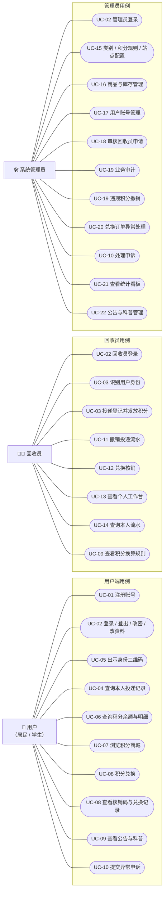
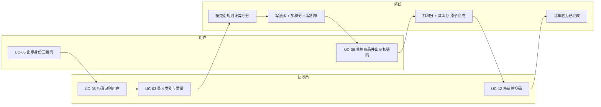
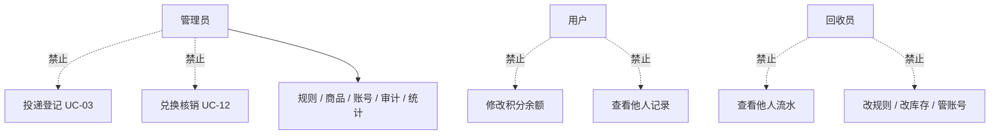

# 用例图与用例描述

| 项目 | 内容 |
| --- | --- |
| 文档版本 | v1.1（阶段①评审稿） |
| 编写 | 魏鸿 |
| 关联文档 | [需求分析报告-v1.md](需求分析报告-v1.md)、[功能结构图-v1.md](功能结构图-v1.md)、[../api.md](../api.md) |
| 图形约定 | 用例编号 UC-01～UC-22，与需求编号 FR-xx、接口编号 API-xx 双向可查；「包含」表示必走子流程，「扩展」表示可选分支 |

## 变更记录

| 版本 | 日期 | 修改人 | 说明 |
| --- | --- | --- | --- |
| v0.1 | 阶段①初稿 | 魏鸿 | 按三类角色梳理用例 |
| v1.0 | 阶段①评审稿 | 魏鸿 | 补撤销/审计/申诉等异常用例，与需求编号对齐 |
| v1.1 | 阶段①评审稿 | 魏鸿 | 修正用例编号重复（二维码与积分查询各占一个编号），统一为 UC-01～UC-22 |

---

## 1. 参与者

| 参与者 | 类型 | 说明 | 进入方式 |
| --- | --- | --- | --- |
| 用户（居民/学生） | 主要 | 投递可回收物获取积分，用积分兑换礼品 | 用户端 Web |
| 回收员 | 主要 | 现场称重录入发积分、核销兑换码 | 管理端 Web（回收员视图） |
| 系统管理员 | 主要 | 配置规则、管理商品与账号、审计与统计 | 管理端 Web（管理员视图） |
| 系统计时器 | 次要 | 触发与时间相关的判定（撤销 5 分钟窗口、核销码 30 天有效期） | 后台任务 |

---

## 2. 用例图

### 2.1 总览（三类角色 × 22 个用例）

### 2.2 核心主链路（投递 → 积分 → 兑换 → 核销）

### 2.3 职责分离与越权防护（评审重点）

---

## 3. 用例清单

| 编号 | 用例 | 参与者 | 前置条件 | 简要说明 |
| --- | --- | --- | --- | --- |
| UC-01 | 注册账号 | 用户 | 手机号未注册 | 手机号 + 密码 + 昵称注册，获得 `USER` 角色与初始 0 积分 |
| UC-02 | 登录 / 登出 / 改密 / 改资料 | 三类角色 | 账号存在且状态允许 | 三类角色各自登录入口，返回 JWT；可改密与改资料 |
| UC-03 | 投递登记并发放积分 | 回收员 | 已登录且 `APPROVED`；类别启用且有生效规则 | 识别用户 → 录类别与重量 → 自动算分 → 三写落库 |
| UC-04 | 查询本人投递记录 | 用户 | 已登录 | 分页查看本人流水，含状态与回收员 |
| UC-05 | 出示身份二维码 | 用户 | 已登录 | 展示短时效二维码与 6 位编号，供回收员识别 |
| UC-06 | 查询积分余额与明细 | 用户 | 已登录 | 余额 + 分页明细（收入/支出/撤销/调整/退回） |
| UC-07 | 浏览积分商城 | 用户 | 已登录 | 上架商品列表与详情 |
| UC-08 | 积分兑换并查看核销码 | 用户 | 已登录、积分足够、库存充足 | 原子扣减生成订单与唯一核销码，可查兑换记录 |
| UC-09 | 查看公告与积分规则 | 用户、回收员 | 已登录 | 公告科普；回收员只读查看换算规则 |
| UC-10 | 提交与处理申诉 | 用户、管理员 | 已登录 | 用户提申诉，管理员答复并可联动调整 |
| UC-11 | 撤销投递流水 | 回收员、管理员 | 流水 `NORMAL` 且归属本人 | 5 分钟内自撤；超时需管理员授权 |
| UC-12 | 兑换核销 | 回收员 | 订单 `PENDING` 且未过期 | 核销码校验通过后订单置 `COMPLETED` |
| UC-13 | 查看个人工作台 | 回收员 | 已登录且审核通过 | 今日回收量、发放积分、核销笔数、7 日趋势 |
| UC-14 | 查询本人流水 | 回收员 | 已登录 | 仅本人经手数据 |
| UC-15 | 类别 / 规则 / 站点配置 | 管理员 | 已登录 | 配置换算规则并留历史版本 |
| UC-16 | 商品与库存管理 | 管理员 | 已登录 | 增改商品、上下架、调整库存 |
| UC-17 | 用户账号管理 | 管理员 | 已登录 | 检索、禁用启用、重置密码 |
| UC-18 | 审核回收员申请 | 管理员 | 存在 `PENDING` 申请 | 通过（分配站点）/ 驳回（填原因） |
| UC-19 | 业务审计与违规积分处理 | 管理员 | 已登录 | 全量流水查看、负向调整积分 |
| UC-20 | 兑换订单异常处理 | 管理员 | 存在 `PENDING` 订单 | 取消订单、退积分、恢复库存 |
| UC-21 | 查看统计看板 | 管理员 | 已登录 | 总量、分类占比、趋势、TOP |
| UC-22 | 公告与科普管理 | 管理员 | 已登录 | 增删改查与上下线 |

---

## 4. 关键用例描述

### UC-03 投递登记并发放积分（系统核心用例）

| 项 | 内容 |
| --- | --- |
| 参与者 | 回收员（主）、用户（参与）、系统 |
| 前置条件 | 回收员已登录且状态 `APPROVED`；至少一个垃圾类别处于启用状态并有生效规则 |
| 触发 | 用户在投放点出示二维码，回收员开始录入 |
| 关联接口 | API-DLV-02（识别）、API-DLV-01（登记） |

**主流程**

1. 回收员选择识别方式：扫码（`qrContent`）或输入手机号/6 位用户编号。
2. 系统校验用户存在且状态正常，返回昵称、脱敏手机号、当前积分。
3. 回收员选择垃圾类别（下拉只列启用类别）并输入重量。
4. 系统读取该类别当前生效规则，计算 `积分 = round(重量 × 每公斤积分)`，最低 1 分。
5. 回收员确认提交。
6. 系统在同一事务内：写投递流水（`NORMAL`）→ 累加用户积分余额 → 写积分明细（`INCOME`，附流水号）。
7. 返回流水号、获得积分、变动后余额、可撤销截止时间；用户端查询即可见。

**扩展流**

- 2a. 手机号/编号不存在 → `1005`，提示核对。
- 2b. 用户已被禁用 → `2002`。
- 3a. 重量非法（≤0、>100 kg、小数超 2 位）→ `3010`，回到 3。
- 3b. 类别已停用 → `3009`，刷新类别列表。
- 6a. 数据库异常 → 整体回滚，返回 `5001`，不产生半条数据。

**后置条件**：新增一条 `NORMAL` 流水；用户余额增加；明细多一条收入记录。

**业务规则**：BR-01、BR-02、BR-04（管理员不得执行本用例）。

---

### UC-08 积分兑换（并发关键用例）

| 项 | 内容 |
| --- | --- |
| 参与者 | 用户（主）、系统 |
| 前置条件 | 已登录；商品 `ON`；积分 ≥ 商品积分 × 数量；库存 ≥ 数量 |
| 触发 | 用户在商品详情页点「立即兑换」 |
| 关联接口 | API-EXC-01 |

**主流程**

1. 用户选择数量（默认 1，上限 `min(库存,5)`）。
2. 前端生成 `idempotencyKey` 并提交。
3. 系统校验：商品上架状态、积分余额、库存数量。
4. 系统在事务/锁内完成：扣减用户积分 → 扣减库存（乐观锁版本号）→ 生成订单（`PENDING`）→ 生成唯一核销码 → 写积分明细（`EXPENSE`）。
5. 返回订单号、核销码、剩余积分。

**扩展流**

- 3a. 积分不足 → `3001`（`message` 含差额），不产生订单。
- 3b. 库存不足 → `3002`，刷新库存后回到 1。
- 3c. 商品已下架 → `3003`。
- 3d. 数量非法 → `3013`。
- 4a. 并发冲突（库存被抢占）→ 乐观锁失败，返回 `3002`。
- 4b. 同一幂等键重复提交 → 返回首笔订单，不重复扣减。

**后置条件**：订单 `PENDING`；用户积分与商品库存各减少；核销码唯一可核销。

**业务规则**：BR-07 原子性、BR-08 幂等、BR-09 核销码规则。

---

### UC-12 兑换核销

| 项 | 内容 |
| --- | --- |
| 参与者 | 回收员（主）、用户（参与） |
| 前置条件 | 订单 `PENDING` 且未超过核销码有效期 |
| 触发 | 用户到站点出示核销码 |
| 关联接口 | API-EXC-07（预览）、API-EXC-03（核销） |

**主流程**

1. 回收员输入或扫描核销码，先调预览接口。
2. 系统返回商品、数量、用户昵称（脱敏）、下单时间，供核对。
3. 回收员确认交货，提交核销。
4. 系统置订单 `COMPLETED`，记录核销人、核销站点、核销时间。
5. 用户端订单状态同步为已完成。

**扩展流**

- 2a. 核销码不存在/格式错误 → `3005`，提示重输。
- 2b. 已核销 / 已取消 / 已过期 → `3005` 并显示具体状态，禁止重复核销。
- 3a. 回收员取消确认 → 不做变更。

**后置条件**：订单终态 `COMPLETED`；库存与积分不再变动。

**业务规则**：BR-04（管理员不得核销）、BR-09。

---

### UC-11 撤销投递流水

| 项 | 内容 |
| --- | --- |
| 参与者 | 回收员（主）、管理员（授权） |
| 前置条件 | 流水 `NORMAL` 且由本人创建 |
| 触发 | 发现录入错误 |
| 关联接口 | API-DLV-04（自助）、API-DLV-06（授权） |

**主流程**

1. 回收员在「本人流水」中选中一条记录，点「撤销」。
2. 系统校验：归属本人、状态 `NORMAL`、距创建 ≤ 5 分钟。
3. 回收员填写撤销原因（10–100 字）并二次确认。
4. 系统置流水 `REVOKED`，扣回该笔积分，写 `REVOKE` 明细（负向），记录撤销人与原因。

**扩展流**

- 2a. 超过 5 分钟 → `3007`，提示「已超时，请联系管理员授权撤销」。
- 2b. 已被撤销 → `3008`。
- 4a. 用户余额不足以扣回 → `3001`，回收员路径直接失败；改走管理员授权（UC-19），余额扣至 0，差额进异常台账。
- 授权撤销：管理员选择流水、填原因，直接执行步骤 4（不受 5 分钟限制，必须留痕）。

**后置条件**：流水 `REVOKED`；用户余额减少；明细多一条撤销记录；统计口径自动排除该笔（BR-14）。

---

### UC-18 审核回收员申请

| 项 | 内容 |
| --- | --- |
| 参与者 | 管理员（主）、回收员（申请方） |
| 前置条件 | 回收员已提交申请，状态 `PENDING` |
| 触发 | 管理员进入「回收员审核」列表 |
| 关联接口 | API-ACC-04 / 05 / 06 / 07 |

**主流程**

1. 管理员查看待审列表：姓名、手机号、工号、申请说明、申请时间。
2. 审核通过 → 选择所属站点（必须启用），账号置 `APPROVED`，此后可登录。
3. 审核驳回 → 填写驳回原因（10–200 字），账号置 `REJECTED`，保留申请记录。

**扩展流**

- 3a. 驳回后对方重新提交申请 → 状态回到 `PENDING`，重新进入待审列表。
- 通过后管理员可禁用/启用（`APPROVED` ⇄ `DISABLED`）；禁用后登录返回 `2002`。

**后置条件**：账号状态变更；通过的回收员可执行 UC-03、UC-12。

---

### UC-19 业务审计与违规积分处理

| 项 | 内容 |
| --- | --- |
| 参与者 | 管理员 |
| 前置条件 | 已登录 |
| 触发 | 例行审计 / 用户申诉 / 异常提醒 |
| 关联接口 | API-DLV-05（审计列表）、API-DLV-06（授权撤销）、API-ACC-08（积分调整） |

**主流程**

1. 管理员按回收员、时间区间、类别筛选全量投递流水。
2. 系统返回列表与汇总（笔数、总重量、总积分），并标记异常记录。
3. 管理员对可疑记录执行「授权撤销」（UC-11 的授权分支）。
4. 管理员对指定用户执行负向积分调整：填调整值与原因，系统写 `ADJUST` 明细并记录操作人。

**异常判定建议**（阈值写死在 `v0.1`，可配置化留到后续）：单笔重量 > 50 kg；同一用户 1 小时内 ≥ 5 笔；同一回收员 10 分钟内 ≥ 10 笔。

**扩展流**

- 2a. 无数据 → 返回空列表，不报错。
- 4a. 调整导致余额为负 → `3011`，提示先核实或走申诉补偿。

**后置条件**：所有调整可追溯（操作人、时间、原因、前后余额）。

---

### UC-21 查看统计看板

| 项 | 内容 |
| --- | --- |
| 参与者 | 管理员 |
| 前置条件 | 已登录 |
| 触发 | 进入看板页 |
| 关联接口 | API-STA-01～04 |

**主流程**

1. 系统返回总量卡片：总回收重量、累计发放积分、累计消耗积分、注册用户数、已完成订单数、待办数（待审回收员、待处理申诉、超期未核销订单）。
2. 返回分类占比：各类别重量、占比、发放积分。
3. 返回趋势：近 7 / 30 日每日回收重量与发放积分。
4. 返回 TOP：兑换最多的商品、投递最多的用户（脱敏）。

**扩展流**

- 1a. 数据为空 → 卡片显示 0，图表显示空态提示。

**后置条件**：只读，不产生数据变更。统计口径遵守 BR-14（只统计 `NORMAL` 流水与 `COMPLETED` 订单）。

---

### UC-10 提交与处理申诉

| 项 | 内容 |
| --- | --- |
| 参与者 | 用户（提交）、管理员（处理） |
| 前置条件 | 用户已登录；申诉对象为本人数据 |
| 触发 | 用户对某笔投递或兑换有异议 |
| 关联接口 | API-USER-09/10、API-ACC-09/10 |

**主流程**

1. 用户在投递记录或订单详情页点「申诉」，选择关联对象并填写描述（10–500 字）。
2. 系统生成申诉（`PENDING`）。
3. 管理员在申诉列表中查看并填写处理结论，置为已处理。
4. 若需补/扣积分，管理员另调积分调整接口（UC-19），并在结论中写明关联明细号。
5. 用户端可查看处理结果。

**扩展流**

- 1a. 描述过短 → `1001`。
- 1b. 关联对象不属于本人 → `1003`。
- 3a. 管理员驳回 → 状态 `REJECTED`，必须写理由。
- 3b. 申诉已被处理 → `1006`。

**后置条件**：申诉状态终态；积分变动另有独立明细可追溯。
