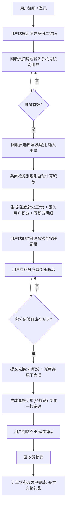
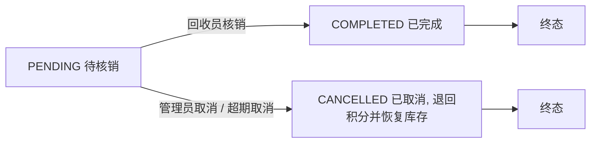

# 需求分析报告

| 项目 | 内容 |
| --- | --- |
| 项目名称 | 校园垃圾回收积分系统（2026NUAA-） |
| 文档版本 | v1.0（阶段①评审稿） |
| 编写 | 魏鸿 |
| 评审 | 全员（赵哲禹、杨光磊、邓裕达、陈益苇） |
| 文档状态 | 待评审；评审通过后功能范围冻结，进入详细设计 |
| 关联文档 | [用例图-v1.md](用例图-v1.md)、[功能结构图-v1.md](功能结构图-v1.md)、[页面清单与交互说明-v1.md](页面清单与交互说明-v1.md)、[接口契约 ../api.md](../api.md) |
| 上位依据 | 仓库 README.md、小组分工.md、协作须知.md、CLAUDE.md |

## 变更记录

| 版本 | 日期 | 修改人 | 说明 |
| --- | --- | --- | --- |
| v0.1 | 阶段①初稿 | 魏鸿 | 搭建章节骨架，梳理角色与功能清单 |
| v1.0 | 阶段①评审稿 | 魏鸿 | 补齐业务规则（BR）、权限矩阵、非功能需求与验收标准，功能编号与用例、接口对齐 |

---

## 1. 项目概述

### 1.1 背景

校园内的可回收物（废纸、塑料瓶、金属、旧衣物等）回收主要依靠流动回收人员和零散投放点，存在三个问题：回收量无记录、参与者无激励、数据无法统计。学校需要一套轻量的信息化系统，把「投递—称重—积分—兑换」这条链路搬到线上，让回收行为可记录、可激励、可追溯。

### 1.2 建设目标

| 编号 | 目标 | 可度量标准 |
| --- | --- | --- |
| G-1 | 回收流程线上化 | 一次投递从识别用户到积分到账 ≤ 3 次页面操作，全程留流水 |
| G-2 | 积分结算自动化 | 积分由系统按类别规则自动计算，任何角色都无法手工改用户余额 |
| G-3 | 兑换闭环可核销 | 兑换生成唯一核销码，线下交货后线上核销完成，订单状态可查 |
| G-4 | 业务数据可审计 | 管理员可查看全部回收流水与积分明细，能追溯每一条积分的来源 |
| G-5 | 成绩可交付 | 完成四阶段产出，线上环境可完整走通主流程，并产出开发报告与答辩 PPT |

### 1.3 系统边界

**范围内（本期做）**

1. 用户（居民/学生）端 Web：注册登录、身份二维码、投递记录、积分明细、积分商城兑换、兑换记录、公告科普、异常申诉。
2. 管理端 Web（回收员角色）：扫码/手机号识别用户、投递登记自动发分、兑换核销、个人工作台、本人流水、限时撤销申请。
3. 管理端 Web（管理员角色）：垃圾类别与积分规则配置、回收站点维护、商品与库存管理、账号管理、回收员审核、业务审计、订单异常处理、申诉处理、统计看板、公告管理。
4. 后端 REST API：JWT 登录认证 + RBAC 权限控制、数据隔离、兑换并发控制、统计聚合、文件上传。

**范围外（本期不做，需在答辩时说明）**

| 排除项 | 原因 |
| --- | --- |
| 在线支付、积分充值、积分提现 | 积分是本系统虚拟激励，不涉及资金 |
| 物流与配送、礼品寄送 | 礼品在指定站点线下领取 |
| 原生 App、小程序 | 课程作业以 Web 为主，移动端用响应式页面 |
| 图像识别/称重硬件对接 | 二维码与手机号识别已满足需求，硬件超出条件 |
| 多校区、多组织架构 | 单校区单组织，靠「回收站点」实现物理位置区分 |
| 消息推送（短信/邮件） | 通知走站内公告，不做外发通道 |

### 1.4 用户特征与使用场景

| 角色 | 人群 | 使用场景 | 设备与环境 |
| --- | --- | --- | --- |
| 用户 | 在校学生、宿舍区居民 | 提着垃圾到投放点，出示二维码；回宿舍后查积分、逛商城 | 手机浏览器为主，弱网可用 |
| 回收员 | 勤工助学学生、物业回收人员 | 站点现场，一手操作手机，一手拿称 | 手机浏览器，单手操作，扫码靠摄像头 |
| 管理员 | 后勤/项目组管理人员 | 办公室电脑，配置规则、审核账号、看数据 | PC 浏览器 1440px 以上 |

---

## 2. 角色与术语

### 2.1 角色定义

| 角色码 | 角色 | 入口 | 职责边界 |
| --- | --- | --- | --- |
| `USER` | 用户（居民/学生） | 用户端 | 只能看自己的资料、二维码、投递记录、积分明细、兑换记录；不能改积分、不能改库存 |
| `RECYCLER` | 回收员 | 管理端 | 只能做称重录入与核销，只能看本人流水；不能改规则、管商品、管账号 |
| `ADMIN` | 系统管理员 | 管理端 | 管规则、商品、账号、审计、统计；**不参与称重录入与核销**（职责分离） |
| — | 匿名访客 | — | 仅能访问登录页；所有业务接口需登录 |

### 2.2 术语表

| 术语 | 定义 |
| --- | --- |
| 投递流水（delivery record） | 一次「某回收员为某用户称重并发放积分」的记录，含类别、重量、积分、状态 |
| 积分明细（points log） | 积分的每一次变动记录，含收入/支出/撤销/调整/退回，附变动后余额 |
| 积分换算规则（points rule） | 某垃圾类别下「每公斤多少积分」的配置，可带生效时间，历史版本可查 |
| 核销码（redeem code） | 兑换成功后生成的 8 位一次性凭证，回收员凭码交货并核销 |
| 撤销（revoke） | 因录入错误作废一条投递流水，同时扣回已发放积分 |
| 职责分离 | 管理员不得做称重录入与核销，避免「自己录、自己发、自己核」 |
| 数据隔离 | 回收员的查询结果只能包含 `recycler_id = 当前登录人` 的数据 |

---

## 3. 总体业务流程

### 3.1 业务主流程

### 3.2 异常与补偿流程

| 编号 | 场景 | 处理方式 |
| --- | --- | --- |
| E-1 | 回收员录错重量/类别 | 5 分钟内自行发起撤销申请；撤销后流水置 `REVOKED`，积分扣回 |
| E-2 | 超过 5 分钟发现录错 | 由回收员向管理员说明，管理员授权撤销（同一流程，需填原因并留痕） |
| E-3 | 撤销时用户积分不足（已兑换用掉） | 余额扣至 0，差额记入异常台账，由管理员处理申诉 |
| E-4 | 兑换时积分不足 / 库存不足 / 商品已下架 | 请求被拒绝并返回明确错误码，不产生订单，不扣积分 |
| E-5 | 同一请求重复提交（双击、弱网重试） | 兑换接口按幂等键去重，只生成一笔订单 |
| E-6 | 核销码错误 / 已核销 / 已失效 | 核销失败并提示状态，订单不变 |
| E-7 | 商品缺货无法交付 | 管理员取消订单，退回积分并恢复库存 |
| E-8 | 用户认为积分或订单有误 | 用户在用户端提交申诉，管理员处理并答复 |

### 3.3 状态机

**投递流水**：`NORMAL`（正常）→ `REVOKED`（已撤销，终态）。仅 `NORMAL` 可撤销。

**兑换订单**：

**回收员账号**：`PENDING`（待审核）→ `APPROVED`（已通过）/ `REJECTED`（已驳回）；`APPROVED` ⇄ `DISABLED`（禁用/启用）。

---

## 4. 功能需求

优先级：**P0** 必须交付（不做则主流程不通）、**P1** 应交付（影响验收演示）、**P2** 可选（有余力再做）。

### 4.1 用户端（USER）

| 编号 | 功能 | 优先级 | 需求描述与规则 | 用例 | 接口 |
| --- | --- | --- | --- | --- | --- |
| FR-U-01 | 注册 | P0 | 手机号 + 密码 + 昵称注册；手机号全局唯一（已注册则拒绝）；密码 8–20 位且同时含字母与数字；昵称 1–20 字符。注册即获得 `USER` 角色，初始积分 0 | UC-01 | API-AUTH-01 |
| FR-U-02 | 登录 / 登出 | P0 | 手机号 + 密码登录，成功后返回 JWT；登出使本地令牌失效。连续失败 5 次锁定 10 分钟（可选，P1） | UC-02 | API-AUTH-02/05 |
| FR-U-03 | 个人资料 | P0 | 可改昵称、头像、收货地址备注；**手机号不可自行修改**（账号标识），需联系管理员，见 BR-10 | UC-02 | API-USER-01/02 |
| FR-U-04 | 修改密码 | P0 | 需校验原密码；新密码策略同注册；修改后要求重新登录 | UC-02 | API-AUTH-06 |
| FR-U-05 | 身份二维码 | P0 | 展示本人专属二维码（内容为短时效带签名令牌，默认 10 分钟刷新），供回收员扫码识别；同时提供 6 位数字的用户编号便于人工输入 | UC-05 | API-USER-03 |
| FR-U-06 | 投递记录查询 | P0 | 分页查看本人投递记录：时间、类别、重量、获得积分、回收员、状态（正常/已撤销）；可按类别与时间范围筛选；**只能看本人** | UC-04 | API-USER-06 |
| FR-U-07 | 积分余额与明细 | P0 | 展示当前余额；明细分页列出时间、变动值（正/负）、变动后余额、类型（收入/支出/撤销/调整/退回）、来源单号与备注 | UC-06 | API-USER-04/05 |
| FR-U-08 | 商城浏览 | P0 | 只展示「上架」商品；列表含图片、名称、所需积分、剩余库存；支持关键字搜索与排序（积分升/降序）；详情页展示描述与兑换须知 | UC-07 | API-PRD-01/02 |
| FR-U-09 | 积分兑换 | P0 | 选择商品与数量（默认 1，上限 `min(库存, 5)`），校验积分与库存后**原子扣减**并生成订单与唯一核销码；积分不足/库存不足/已下架一律拒绝并明确提示 | UC-08 | API-EXC-01 |
| FR-U-10 | 兑换记录 | P0 | 分页查看本人兑换记录：订单号、商品、数量、消耗积分、状态、核销码；`PENDING` 时突出显示核销码，`COMPLETED` 后展示核销时间与核销站点 | UC-08 | API-USER-07/08 |
| FR-U-11 | 公告与科普 | P1 | 查看已发布公告列表与详情，分「系统公告」「环保科普」两类 | UC-09 | API-ANN-01/02 |
| FR-U-12 | 异常申诉 | P1 | 对某条投递记录或兑换订单发起申诉，填写问题描述；可查看本人的申诉处理结果 | UC-10 | API-USER-09/10 |

**用户端明确不提供的功能**（评审时重点确认，防止越权需求混入）：修改积分余额、代他人查询记录、修改商品库存或上下架、直接改自己的手机号、查看他人资料。

### 4.2 管理端 - 回收员（RECYCLER）

| 编号 | 功能 | 优先级 | 需求描述与规则 | 用例 | 接口 |
| --- | --- | --- | --- | --- | --- |
| FR-R-01 | 回收员登录 | P0 | 手机号 + 密码登录；账号状态必须是 `APPROVED`，`PENDING`/`REJECTED`/`DISABLED` 一律拒绝并说明原因 | UC-02 | API-AUTH-03 |
| FR-R-02 | 识别用户 | P0 | 支持两种方式：扫用户二维码（提交令牌串解析）、输入手机号或 6 位用户编号；识别成功后展示昵称、脱敏手机号（138****1234）、当前积分，供回收员核对 | UC-03 | API-DLV-02 |
| FR-R-03 | 投递登记（发积分） | P0 | 选择垃圾类别（只列启用类别）、输入重量（0.01–100 kg，两位小数），系统按当前生效规则算分并落库：写流水 + 加余额 + 写积分明细，三者同一事务 | UC-03 | API-DLV-01 |
| FR-R-04 | 撤销申请 | P1 | 仅对本人创建、状态 `NORMAL`、且创建时间在 5 分钟内的流水可撤销；必须填原因；撤销后流水 `REVOKED` 并扣回积分。超时提示「需管理员授权」 | UC-11 | API-DLV-04 |
| FR-R-05 | 兑换核销 | P0 | 输入/扫描用户核销码，二次确认后完成核销：订单 `PENDING → COMPLETED`，记录核销人与时间；重复核销/无效码必须失败 | UC-12 | API-EXC-03 |
| FR-R-06 | 工作台 | P0 | 展示今日回收重量、今日发放积分、今日核销笔数、近 7 日趋势、本周排名（可选 P2） | UC-13 | API-STA-05 |
| FR-R-07 | 本人流水 | P0 | 分页查看本人经手的投递流水与核销记录，**服务端强制按登录人过滤**，不接受前端传入他人 id | UC-14 | API-DLV-03、API-EXC-04 |
| FR-R-08 | 查看积分规则 | P1 | 只读查看各启用类别的当前换算规则，供现场向用户解释 | UC-09 | API-CAT-01 |

**回收员禁止项**：改积分规则、改商品与库存、查看他人流水、管理用户账号、直接改用户积分。

### 4.3 管理端 - 管理员（ADMIN）

| 编号 | 功能 | 优先级 | 需求描述与规则 | 用例 | 接口 |
| --- | --- | --- | --- | --- | --- |
| FR-A-01 | 管理员登录 | P0 | 用户名 + 密码登录，账号为预置数据，不开放自助注册 | UC-02 | API-AUTH-04 |
| FR-A-02 | 垃圾类别管理 | P0 | 增删改查类别（名称、编码、单位、图标、排序、启用状态）；编码唯一；被流水引用的类别只能停用不能删除 | UC-15 | API-CAT-02/03/05 |
| FR-A-03 | 积分规则配置 | P0 | 为类别设置「每公斤积分」与生效时间；同一类别同一时间只有一条生效规则；调价生成新版本，历史可查，**历史流水积分不追溯重算** | UC-15 | API-CAT-06/07 |
| FR-A-04 | 回收站点维护 | P1 | 站点名称、地址、开放时间、负责人、启用状态 | UC-15 | API-SITE-01~04 |
| FR-A-05 | 商品管理 | P0 | 新增/编辑商品（名称、描述、图片、所需积分、库存、规格）；设置上下架；被订单引用的商品只能下架不能物理删除 | UC-16 | API-PRD-03/04/05/07 |
| FR-A-06 | 库存调整 | P1 | 支持「设为指定值」与「增减」两种模式，必须记录调整人、原值、新值、原因 | UC-16 | API-PRD-06 |
| FR-A-07 | 用户账号管理 | P0 | 按手机号/昵称检索；禁用/启用；重置密码（生成临时密码一次性展示，**不允许直接设置用户新密码**）；禁用后该用户所有接口返回账号禁用 | UC-17 | API-ACC-01~03 |
| FR-A-08 | 回收员审核 | P0 | 查看待审核列表与申请资料，通过（可分配站点）或驳回（填原因）；驳回后账号不可登录；支持禁用/启用已通过账号 | UC-18 | API-ACC-04~07 |
| FR-A-09 | 业务审计 | P1 | 查看全量投递流水（可按回收员、时间、类别筛选），标记异常（如同一用户短时间内高频投递、单笔重量异常）；可导出 CSV（P2） | UC-19 | API-DLV-05 |
| FR-A-10 | 违规积分撤销 | P1 | 对指定用户执行负向调整并必填原因，生成 `ADJUST` 明细；余额不足时拒绝（不得出现负余额） | UC-19 | API-ACC-08 |
| FR-A-11 | 兑换订单管理 | P1 | 查看全部订单；对 `PENDING` 订单执行取消（退回积分、恢复库存、必填原因）；处理缺货 | UC-20 | API-EXC-05/06 |
| FR-A-12 | 申诉处理 | P1 | 查看申诉列表，填写处理结论；可关联调整积分或订单状态 | UC-10 | API-ACC-09/10 |
| FR-A-13 | 统计看板 | P0 | 总量卡片（总回收重量、累计发放积分、注册用户数、累计订单数）、分类占比饼图、近 N 日趋势、TOP 用户/商品、待办数量 | UC-21 | API-STA-01~04 |
| FR-A-14 | 公告与科普管理 | P1 | 发布、编辑、删除、上下线公告；类型区分公告/科普 | UC-22 | API-ANN-03~06 |

**管理员禁止项**：称重录入、兑换核销、直接修改用户密码。审计中若发现管理员账号做过投递登记或核销，视为流程违规。

### 4.4 后端横切能力

| 编号 | 功能 | 优先级 | 需求描述 |
| --- | --- | --- | --- |
| FR-C-01 | 鉴权 | P0 | JWT 登录态；令牌含 `userId`、`role`、`exp`；除注册与登录外所有接口校验令牌 |
| FR-C-02 | 权限控制（RBAC） | P0 | 按角色拦截接口；`USER`/`RECYCLER` 调用管理员接口返回 403；回收员接口额外校验数据归属 |
| FR-C-03 | 统一响应与错误码 | P0 | `{code, message, data}`，错误码集中定义，见接口契约 |
| FR-C-04 | 数据隔离 | P0 | 回收员查询强制附加 `recycler_id = 当前登录人` |
| FR-C-05 | 文件上传 | P1 | 支持商品图、头像、公告图上传；限制类型（jpg/png/webp）与大小（≤2 MB）；返回可访问 URL |
| FR-C-06 | 事务与并发 | P0 | 投递登记三写同一事务；兑换的积分扣减与库存扣减必须原子，防超卖、防扣成负数 |
| FR-C-07 | 操作审计日志 | P2 | 记录关键操作（规则变更、库存调整、积分调整、取消订单）的操作人、时间、前后值 |

---

## 5. 业务规则（BR）

| 编号 | 规则 | 约束来源 | 对应需求 |
| --- | --- | --- | --- |
| BR-01 | **积分只能由回收员录入投递、系统奖励、管理员调整、撤销退回产生**。用户端不存在任何修改积分余额的接口；任何请求体里的积分字段一律忽略 | 核心不变量 1 | FR-U-07、FR-R-03、FR-A-10 |
| BR-02 | **积分计算公式**：`积分 = round(重量kg × 类别每公斤积分)`，四舍五入取整；结果小于 1 且重量大于 0 时按 1 分计（**待评审确认**，见第 10 节） | 需求规则 | FR-R-03 |
| BR-03 | **余额不得为负**：任何扣减前校验余额；撤销时余额不足则拒绝（回收员自撤），管理员授权撤销时扣至 0 并将差额计入异常台账 | 一致性 | FR-R-04、FR-A-10 |
| BR-04 | **职责分离**：管理员不得调用投递登记与核销接口，服务端按角色直接拒绝 | 核心不变量 2 | FR-R-03、FR-R-05 |
| BR-05 | **数据隔离**：回收员只能访问 `recycler_id = 当前登录人` 的流水；管理员可看全部 | 核心不变量 3 | FR-R-07 |
| BR-06 | **密码策略**：8–20 位、含字母与数字；存储加盐哈希（BCrypt）；管理员只能「重置」为临时密码，不能指定用户新密码 | 核心不变量 4 | FR-A-07 |
| BR-07 | **兑换原子性**：扣积分与扣库存必须同事务或加锁（乐观锁版本号 / Redis 分布式锁），任一失败整体回滚，不得出现「扣了积分没减库存」 | 核心不变量 5 | FR-U-09 |
| BR-08 | **兑换幂等**：同一用户同一 `idempotencyKey` 在 24 小时内只生成一笔订单；重复提交返回首笔结果 | 一致性 | FR-U-09 |
| BR-09 | **核销码**：8 位大写字母+数字，全局唯一，一次性使用；有效期 30 天，超期由管理员取消并退回积分 | 需求规则 | FR-R-05、FR-A-11 |
| BR-10 | **账号唯一性**：手机号是用户与回收员的唯一登录标识，注册后不可自行修改；如需修改由管理员在后台操作并留痕 | 需求规则 | FR-U-03 |
| BR-11 | **撤销窗口**：回收员自撤销窗口为流水创建后 5 分钟，且每条流水只能撤销一次；超出需管理员授权 | 核心不变量 6 | FR-R-04 |
| BR-12 | **删除即停用**：类别、商品、站点、账号一律软删除（状态位），历史流水与订单必须保持可查、可统计 | 数据完整性 | FR-A-02/05 |
| BR-13 | **金额与重量**：积分、库存为整数；重量保留 2 位小数，单位 kg；时间统一 ISO 8601、服务器时区 Asia/Shanghai | 接口契约 | 全部 |
| BR-14 | **统计口径**：总回收重量与总发放积分只统计 `NORMAL` 流水；订单只统计 `COMPLETED`；被撤销数据单独标记、不计入正向指标 | 数据一致性 | FR-A-13 |

---

## 6. 权限矩阵

| 功能域 | 匿名 | USER | RECYCLER | ADMIN |
| --- | --- | --- | --- | --- |
| 注册 / 登录 / 找回 | 允许（仅登录注册） | 允许 | 允许 | 允许（不开放注册） |
| 本人资料、二维码、积分、投递记录、兑换记录 | 禁止 | 仅本人 | 禁止 | 禁止（可看他人汇总，不可看明细二维码） |
| 投递登记 | 禁止 | 禁止 | 允许（仅本人流水） | **禁止**（职责分离） |
| 撤销申请 | 禁止 | 禁止 | 5 分钟内、仅本人创建 | 授权撤销（需原因） |
| 兑换下单 | 禁止 | 允许（仅本人） | 禁止 | 禁止 |
| 兑换核销 | 禁止 | 禁止 | 允许 | **禁止**（职责分离） |
| 类别 / 规则 / 站点配置 | 禁止 | 禁止 | 只读 | 允许 |
| 商品与库存 | 禁止 | 只读（上架商品） | 只读 | 允许 |
| 账号、回收员审核 | 禁止 | 禁止 | 禁止 | 允许 |
| 审计、积分调整、订单取消、申诉处理 | 禁止 | 禁止 | 禁止 | 允许 |
| 统计看板 | 禁止 | 禁止 | 本人工作台 | 全局 |
| 公告管理 | 禁止 | 禁止 | 禁止 | 允许 |
| 文件上传 | 禁止 | 头像 | 商品图（P2） | 全部 |

---

## 7. 非功能需求

| 编号 | 类别 | 需求 | 量化指标 / 验证方式 |
| --- | --- | --- | --- |
| NFR-01 | 性能 | 常规查询接口响应 | P95 ≤ 500 ms（本地/学生机，数据量见 NFR-09） |
| NFR-02 | 性能 | 投递登记、兑换写操作 | P95 ≤ 800 ms |
| NFR-03 | 并发 | 兑换并发安全 | 库存 1 件时 20 并发兑换，成功 1 笔、失败 19 笔，库存不为负、无超卖（阶段③用例） |
| NFR-04 | 并发 | 同一用户并发兑换 | 余额 100、商品 60 积分，10 并发只能成交 1 笔（阶段③用例） |
| NFR-05 | 安全 | 认证与授权 | JWT 签名密钥从环境变量读取；无令牌访问业务接口 401；越权访问 403；密码不可逆存储 |
| NFR-06 | 安全 | 输入校验 | 所有入参服务端校验（长度、范围、枚举、格式）；SQL 全参数化；上传文件校验类型与大小 |
| NFR-07 | 安全 | 敏感信息 | 日志与响应不得出现密码、完整手机号（除本人）、JWT 密钥；`.env` 不入库 |
| NFR-08 | 可用性 | 交互规范 | 关键操作二次确认（撤销、核销、取消订单）；失败提示可理解、含错误码；所有列表支持空态 |
| NFR-09 | 容量 | 数据规模 | 用户 ≤ 1000、回收员 ≤ 50、商品 ≤ 200、流水 ≤ 5 万条/学期；单表百万级前不需分库分表 |
| NFR-10 | 兼容性 | 浏览器与终端 | Chrome / Edge 最近两个大版本；管理端 PC 1440×900 起；用户端 375px 起响应式 |
| NFR-11 | 可维护性 | 结构规范 | 前后端分离、接口契约唯一（docs/api.md）；分支与 commit 遵守协作须知；关键逻辑有注释 |
| NFR-12 | 部署 | 环境 | 学生云服务器 2 核 4G，Docker Compose 一键起 MySQL 8.0 + 后端 + Nginx；80/443 对外，3306 不对外 |
| NFR-13 | 数据安全 | 备份 | 上线前与每次发版前 `mysqldump` 备份，备份文件不入库 |
| NFR-14 | 可测试性 | 测试资产 | 每个接口在 `tests/postman/` 有对应用例；越权、边界值、并发三类必测 |

---

## 8. 用例清单

完整用例图与用例描述见 [用例图-v1.md](用例图-v1.md)。

| 用例编号 | 用例名称 | 主要参与者 | 对应需求 |
| --- | --- | --- | --- |
| UC-01 | 注册账号 | 用户 | FR-U-01 |
| UC-02 | 登录 / 登出 / 改密 / 改资料 | 用户、回收员、管理员 | FR-U-02/03/04、FR-R-01、FR-A-01 |
| UC-03 | 投递登记并发放积分 | 回收员 | FR-R-02/03、FR-U-05 |
| UC-04 | 查询本人投递记录 | 用户 | FR-U-06 |
| UC-05 | 出示身份二维码 | 用户 | FR-U-05 |
| UC-06 | 查询积分余额与明细 | 用户 | FR-U-07 |
| UC-07 | 浏览积分商城 | 用户 | FR-U-08 |
| UC-08 | 积分兑换并查看核销码 | 用户 | FR-U-09/10 |
| UC-09 | 查看公告与积分规则 | 用户、回收员 | FR-U-11、FR-R-08 |
| UC-10 | 提交与处理申诉 | 用户、管理员 | FR-U-12、FR-A-12 |
| UC-11 | 撤销投递流水 | 回收员、管理员 | FR-R-04、FR-A-10 |
| UC-12 | 兑换核销 | 回收员 | FR-R-05 |
| UC-13 | 查看个人工作台 | 回收员 | FR-R-06 |
| UC-14 | 查询本人流水 | 回收员 | FR-R-07 |
| UC-15 | 配置类别、积分规则与站点 | 管理员 | FR-A-02/03/04 |
| UC-16 | 管理商品与库存 | 管理员 | FR-A-05/06 |
| UC-17 | 管理用户账号 | 管理员 | FR-A-07 |
| UC-18 | 审核回收员申请 | 管理员 | FR-A-08 |
| UC-19 | 业务审计与违规积分处理 | 管理员 | FR-A-09/10 |
| UC-20 | 处理兑换订单异常 | 管理员 | FR-A-11 |
| UC-21 | 查看统计看板 | 管理员 | FR-A-13 |
| UC-22 | 管理公告与科普 | 管理员 | FR-A-14 |

---

## 9. 数据需求（概念级）

完整 E-R 图与表结构见阶段①设计文档 `docs/design/`。核心实体 12 张：

| 实体 | 说明 | 关键属性 | 主要关系 |
| --- | --- | --- | --- |
| 用户 user | 学生/居民账号 | 手机号、密码哈希、昵称、头像、地址、积分余额、状态 | 1:N 投递流水、1:N 积分明细、1:N 兑换订单 |
| 回收员 recycler | 一线回收人员 | 手机号、姓名、工号、所属站点、审核状态 | 1:N 投递流水（录入人）、1:N 核销记录 |
| 管理员 admin_user | 后台账号 | 用户名、密码哈希、状态 | 1:N 操作日志 |
| 回收站点 site | 线下投放/领取点 | 名称、地址、开放时间、负责人 | 1:N 回收员 |
| 垃圾类别 recycle_category | 可回收物分类 | 名称、编码、单位、排序、启用状态 | 1:N 积分规则、1:N 投递流水 |
| 积分规则 points_rule | 类别换算规则 | 每公斤积分、生效时间、创建人 | N:1 类别 |
| 投递流水 delivery_record | 一次称重发放 | 用户、回收员、类别、重量、积分、状态、撤销信息 | N:1 用户/回收员/类别 |
| 积分明细 points_log | 积分变动账 | 用户、类型、变动值、变动后余额、来源单号、备注 | N:1 用户 |
| 商品 product | 商城礼品 | 名称、图片、所需积分、库存、上架状态 | 1:N 兑换订单 |
| 兑换订单 exchange_order | 兑换记录 | 订单号、用户、商品、数量、消耗积分、状态、核销码、核销人/时间 | N:1 用户/商品 |
| 公告 announcement | 公告与科普 | 标题、正文、类型、状态、发布时间 | — |
| 申诉 appeal | 用户申诉 | 用户、关联对象类型与 id、描述、处理结果、状态 | N:1 用户 |

---

## 10. 约束、假设与待确认事项

### 10.1 约束

1. 阶段①未通过评审不得写业务代码；接口变更须先改 `docs/api.md` 再改代码。
2. 技术栈在阶段①内确定（后端 Java/Spring 或 Node；前端框架由两位前端负责人定），确定后补进各端 README。
3. 一人一账号，禁止借用他人账号提交；分工以 `小组分工.md` 为唯一来源。
4. 密钥、密码、`.env`、构建产物不入库。

### 10.2 待确认事项（评审会逐条拍板）

| 编号 | 事项 | 文档当前取值 | 建议 | 决策人 |
| --- | --- | --- | --- | --- |
| Q-1 | 积分计算取整方式 | 四舍五入，最低 1 分 | 保留两位小数计算、结果四舍五入；低于 1 分按 1 分，避免「投了没分」 | 邓裕达 + 魏鸿 |
| Q-2 | 核销码有效期 | 30 天 | 30 天足够课程演示，超期由管理员取消退分 | 杨光磊 + 魏鸿 |
| Q-3 | 撤销窗口 | 5 分钟、每条一次 | 与需求原文一致 | 邓裕达 |
| Q-4 | 用户能否自行取消未核销订单 | 不做（仅管理员可取消） | 简化状态机，避免退分链路分叉 | 全员 |
| Q-5 | 上传存储方式 | 本地磁盘 + 静态 URL | 课程作业够用，OSS 作为可选扩展 | 陈益苇 |
| Q-6 | 手机号是否可修改 | 不可自行修改 | 由管理员后台改并留痕 | 魏鸿 |
| Q-7 | 是否需要操作审计表 | P2 可选 | 有余力再做，不影响主流程 | 全员 |
| Q-8 | 统计看板刷新方式 | 进入页面拉取，不做实时推送 | 定时轮询 30 秒可选 | 杨光磊 + 陈益苇 |

---

## 11. 验收标准

### 11.1 阶段出口

| 阶段 | 出口条件 |
| --- | --- |
| ① | 本报告与三张图评审通过；`docs/api.md` 冻结 v0.1；权限矩阵与业务规则全员无异议 |
| ② | 三端基于同一契约完成主流程自测（可用 Mock） |
| ③ | 越权、边界值、并发三类用例通过；主要缺陷清零 |
| ④ | 线上环境完整走通第 11.2 节场景；开发报告与答辩 PPT 就绪 |

### 11.2 验收场景（答辩现场按此演示）

| 编号 | 场景 | 通过判据 |
| --- | --- | --- |
| AC-1 | 用户注册 → 登录 → 出示二维码 | 二维码可被回收员识别，识别后显示昵称与脱敏手机号 |
| AC-2 | 回收员录入 2.35 kg 废纸 → 用户微信/浏览器即时看到积分增加 | 流水、余额、明细三处数据一致，积分 = 按规则计算结果 |
| AC-3 | 用户在商城兑换 60 积分商品 → 生成核销码 | 余额减少、库存减少、订单 `PENDING` |
| AC-4 | 回收员输入核销码完成交货 | 订单 `COMPLETED`，记录核销人与时间，重复核销失败 |
| AC-5 | 回收员 5 分钟内撤销上一笔投递 | 流水 `REVOKED`，积分扣回，明细出现撤销记录 |
| AC-6 | 用普通用户 Token 调管理员接口 | 返回 403，数据无变更 |
| AC-7 | 库存为 1 时 20 并发兑换 | 仅 1 笔成功，其余提示库存不足，库存不为负 |
| AC-8 | 管理员看板查看总回收量、总发放积分、分类占比 | 与数据库统计口径一致（只计 `NORMAL`、`COMPLETED`） |

---

## 12. 参考

- 仓库 `README.md`（四阶段流程）、`小组分工.md`（职责唯一来源）、`协作须知.md`（分支/PR/评审）、`CLAUDE.md`（核心不变量）
- `docs/api.md`（接口契约，评审后冻结 v0.1）
- `docs/requirements/用例图-v1.md`、`docs/requirements/功能结构图-v1.md`、`docs/requirements/页面清单与交互说明-v1.md`
